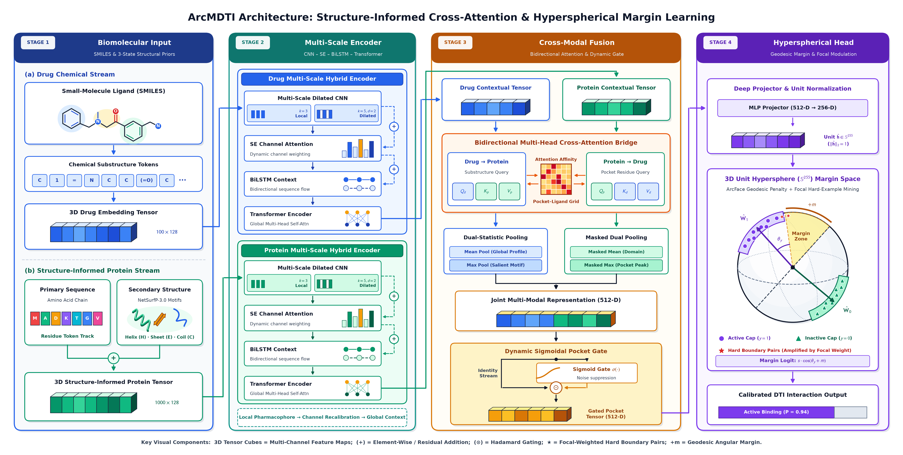
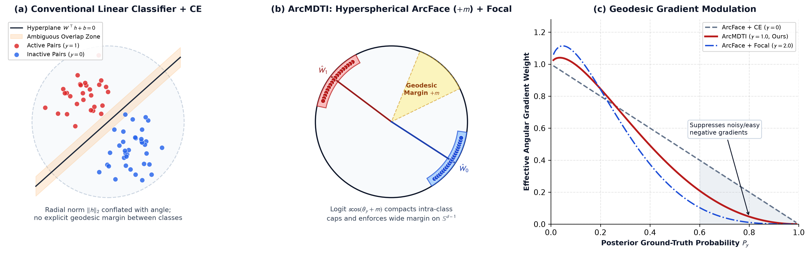

# ArcMDTI: Structure-Informed Angular-Margin Learning with Bidirectional Cross-Attention for Drug–Target Interaction Prediction

Official PyTorch implementation, benchmark datasets, and complete experimental results for **ArcMDTI** (*Structure-Informed Angular-Margin Learning with Bidirectional Cross-Attention for Drug–Target Interaction Prediction*).

<p align="center">
  
</p>

---

## 1. Overview

**ArcMDTI** is an end-to-end structure-informed deep learning framework designed to address three coupled bottlenecks in drug–target interaction (DTI) prediction:
1. **Structure-Informed Multi-Scale Hybrid Encoding (`model.py`)**: Integrates residue-level three-state secondary structure priors ($\alpha$-helix `H`, $\beta$-strand `E`, and random coil `C`) derived from NetSurfP-3.0 directly into primary protein sequence representations, and encodes both drug SMILES strings and target protein macromolecules via a hierarchical **CNN–SE–BiLSTM–Transformer** backbone.
2. **Gated Bidirectional Cross-Attention Fusion (`model.py`)**: Employs symmetric drug-to-protein and protein-to-drug multi-head cross-attention coupled with masked dual-statistic (mean–max) pooling and a learnable sigmoidal feature gate to align ligand pharmacophores with coordinating binding-pocket residues while suppressing non-binding sequence dilution.
3. **Synergistic Hyperspherical Angular-Margin & Focal Optimization (`LossFunction.py`)**: Projects both joint drug–target representations and class prototypes onto a unit hypersphere ($\mathbb{S}^{d-1}$) and optimizes them jointly under an additive geodesic angular margin (**ArcFace**) and **Focal** hard-example modulation to enforce compact intra-class clusters and a calibrated decision boundary under severe screening imbalance.

<p align="center">
  
</p>

---

## 2. Repository Structure

```text
ArcMDTI/
├── DataSets/                          # Benchmark datasets & 3-state secondary structure (.pkl) priors
│   ├── Davis.txt, Davis_ss.pkl
│   ├── KIBA.txt, KIBA_ss.pkl
│   ├── DrugBank.txt, DrugBank_ss.pkl
│   ├── Enzyme.txt, Enzyme_ss.pkl
│   ├── GPCRs.txt, GPCRs_ss.pkl
│   └── ion_channel.txt, ion_channel_ss.pkl
├── model.py                           # ArcMDTI network architecture (CNN-SE-BiLSTM-Transformer + Cross-Attention + ArcFace Head)
├── LossFunction.py                    # Hyperspherical ArcFace + Focal Loss & ablation loss objectives (CE, CosFace, SphereFace)
├── RunModel.py                        # 5-fold cross-validation training, evaluation, and checkpointing engine
├── main.py                            # Main entry point for warm-start 5-fold cross-validation
├── config.py                          # Hyperparameter configurations
├── run_cold_start.py                  # Strict Cold-Drug and Cold-Target out-of-distribution evaluation
├── run_ablation.py                    # Component and loss-objective ablation experiments
├── run_sensitivity.py                 # Hyperspherical scale (s) and angular margin (m) sensitivity analysis
├── run_case_study.py                  # Binding-pocket residue & atom-residue cross-attention interpretability (AAK1 & EDNRA)
├── prepare_datasets.py                # Automated dataset verifier & secondary-structure dictionary builder
├── baseline/                          # Baseline implementations & evaluation scripts (DeepDTA, MPNN, MolTrans, DrugBAN)
├── utils/                             # Data loaders, metric calculators, and atomic epoch loggers
├── result/                            # Complete 5-fold CV, Cold-Start, Ablation, and Sensitivity experimental results (CSVs/JSONs)
├── log/                               # Detailed per-epoch training and validation logs across all benchmarks
├── sci_plots_comparison/              # Publication figures (Framework, Geometry, ROC, PR, Radar, Cold-Start, UMAP, t-SNE, Case Studies)
├── sci_plots_ablation/                # Ablation error-bar and hyperparameter sensitivity figures
├── run_all.sh                         # One-click reproducible experiment pipeline
└── requirements.txt                   # Python package dependencies
```

---

## 3. Environment Setup

```bash
pip install -r requirements.txt
```

**Core dependencies**:
- Python $\ge 3.9$
- PyTorch $\ge 1.13$
- NumPy, SciPy, Pandas, Scikit-learn, Matplotlib, Seaborn, tqdm, umap-learn

---

## 4. Reproducing All Experiments

### 4.1 Verify or Prepare Benchmark Datasets
All six benchmark datasets (`Davis`, `KIBA`, `DrugBank`, `Enzyme`, `GPCRs`, and `ion_channel`) and their precomputed 3-state secondary-structure dictionaries (`*_ss.pkl`) are included in `./DataSets/`. To verify dataset integrity (or rebuild/download automatically if needed):
```bash
python prepare_datasets.py
```

### 4.2 Warm-Start 5-Fold Cross-Validation
```bash
python main.py --dataset Davis --gpu 0
python main.py --dataset KIBA --gpu 0
python main.py --dataset DrugBank --gpu 0
python main.py --dataset Enzyme --gpu 0
python main.py --dataset GPCRs --gpu 0
python main.py --dataset ion_channel --gpu 0
```

### 4.3 Cold-Drug and Cold-Target Generalization
```bash
python run_cold_start.py --dataset Davis --split_mode cold_drug --gpu 0
python run_cold_start.py --dataset Davis --split_mode cold_target --gpu 0
# Or run all datasets and baselines under Cold-Drug and Cold-Target splits:
python run_all_cold.py --gpu 0
```

### 4.4 Architecture & Loss Objective Ablation Studies
```bash
python run_ablation.py --dataset Davis --gpu 0
python run_ablation.py --dataset KIBA --gpu 0
python run_ablation.py --dataset Enzyme --gpu 0
python run_ablation.py --dataset GPCRs --gpu 0
```

### 4.5 Hyperspherical Angular-Margin Sensitivity Analysis ($s \times m$)
```bash
python run_sensitivity.py --dataset Davis --gpu 0
python run_sensitivity.py --dataset GPCRs --gpu 0
```

### 4.6 Structural Binding-Pocket Interpretability Case Studies (AAK1 & EDNRA)
```bash
python run_case_study.py --gpu 0
```

### 4.7 Regenerate All Figures and Summary Tables from Experimental Results
```bash
python make_publication_figures.py
python summarize_cold_start_baselines.py
python make_ablation_errorbar_figures.py
python plot_best_features.py
```

---

## 5. License & Citation

This repository is released for academic research use. If you find **ArcMDTI** useful in your research, please cite our paper.
